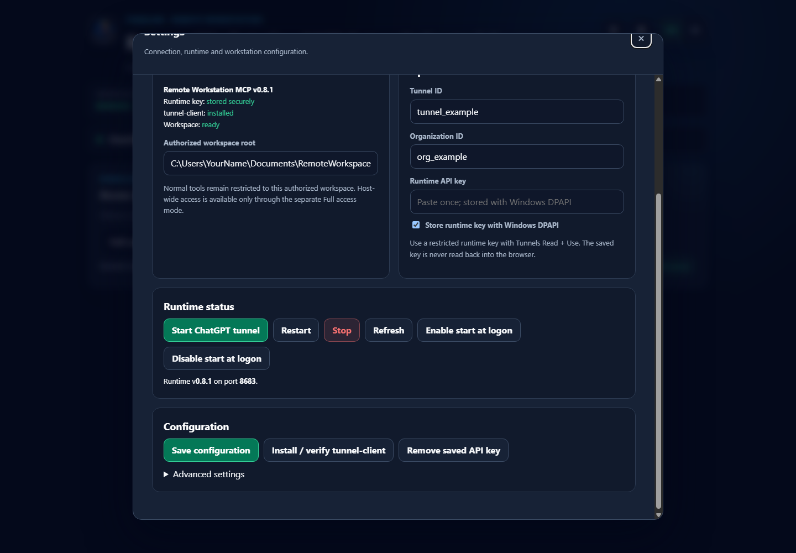
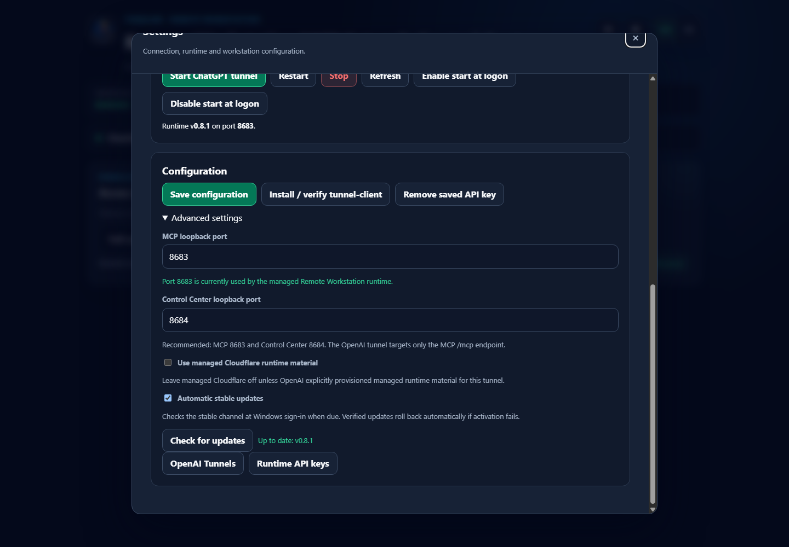

# Windows managed runtime

Remote Workstation MCP v0.8.1 supports a managed one-time Windows installation for normal users and a separate source-repository workflow for contributors.

## One-time managed install

Download `install-windows.cmd` from the latest GitHub Release and run it once.

The managed installer:

1. checks prerequisites and can install Node.js LTS and Git through `winget` when missing;
2. resolves the selected stable GitHub Release;
3. downloads the package and `SHA256SUMS.txt`;
4. verifies SHA-256 before extraction;
5. installs the application into a version slot;
6. installs/verifies the pinned OpenAI `tunnel-client`;
7. creates the stable launcher and Start Menu shortcut;
8. creates/preserves stable `current.txt` and `previous.txt` pointers;
9. initializes stable automatic updates;
10. opens the local Control Center.

A normal user does not need a Git checkout, `npm install`, or a manual rebuild for production use.

## Installed layout

```text
%LOCALAPPDATA%\RemoteWorkstationMCP\
  bin\
    rwmcp.ps1
    install-windows-release.ps1
    update-windows.ps1
  config\
    policy.yaml
    hosts.yaml
  runtime\
    supervisor.json
    control-center.json
    ...logs and operational state...
  audit\
  secrets\
    openai-runtime-api-key.dpapi
  versions\
    v0.7.9\
    v0.8.1\
  current.txt
  previous.txt
  settings.json
  update.json
```

Application version slots are disposable/replaceable. Owner configuration, update state, audit data, and DPAPI-protected secrets live outside the slots.

Do not edit `%LOCALAPPDATA%\RemoteWorkstationMCP\versions\...` as a source repository. Development changes belong in a Git checkout.

## Stable launcher

Managed installs create:

```text
%LOCALAPPDATA%\RemoteWorkstationMCP\bin\rwmcp.ps1
```

Supported launcher actions in v0.8.1 are:

```text
Setup
Start
StartOpenAI
Boot
Stop
Restart
Status
AutostartOn
AutostartOff
UpdateCheck
AutoUpdateOn
AutoUpdateOff
Update
Rollback
```

Examples:

```powershell
$ctl = "$env:LOCALAPPDATA\RemoteWorkstationMCP\bin\rwmcp.ps1"
& $ctl -Action Status
& $ctl -Action UpdateCheck
& $ctl -Action Update
& $ctl -Action Rollback
```

## Automatic startup

RWMCP start-at-logon uses the current-user registry path:

```text
HKCU\Software\Microsoft\Windows\CurrentVersion\Run
```

The registered command targets the stable launcher and uses:

```text
-Action Boot
```

The launcher remains stable while `current.txt` moves between application version slots.

Boot flow:

```text
Windows user signs in
  -> stable launcher runs Boot
  -> check stable update if due
  -> start managed MCP runtime
  -> start/reconnect OpenAI tunnel
  -> verify MCP health + tunnel readiness
```

This startup path is non-elevated and runs with the permissions of the signed-in Windows user.

## Automatic update

Managed Windows installs default to:

```json
{
  "enabled": true,
  "channel": "stable",
  "checkOnStartup": true,
  "checkIntervalHours": 12
}
```

GitHub Releases are the production distribution source. Production update does not run `git pull` against a source tree.

Automatic installation is patch-only. Newer minor or major releases are reported but require explicit owner approval. Manual `Update` remains the approval path for any newer stable release.

Update flow:

1. check the stable GitHub Release channel when due;
2. download the release package and checksum manifest;
3. verify SHA-256;
4. install the candidate into a new version slot;
5. switch the current pointer;
6. start the candidate;
7. verify MCP health and OpenAI tunnel readiness;
8. keep the candidate if healthy;
9. otherwise mark the failed release, restore the previous pointer, and start the previous known-good slot.

Network/update-check failure is non-fatal; the already-installed runtime still starts.

Manual maintenance:

```powershell
& $ctl -Action UpdateCheck
& $ctl -Action Update
& $ctl -Action AutoUpdateOn
& $ctl -Action AutoUpdateOff
& $ctl -Action Rollback
```

## Control Center

Default owner UI:

```text
http://127.0.0.1:8684/
```

Default MCP endpoint:

```text
127.0.0.1:8683
```

The Control Center is loopback-only and separate from the MCP/tunnel runtime. Closing the browser window does not stop the runtime.

The production v0.8.1 Settings modal currently contains:

- Quick setup for ChatGPT;
- Workstation;
- OpenAI connection;
- Runtime status;
- Configuration;
- Advanced settings.

Advanced settings includes the MCP/Control Center ports, managed runtime option, **Automatic patch updates**, and **Check for updates**.





## Access mode and Administrator boundary

The three user-facing access modes are:

- **Read only** - inspect only;
- **Workspace** - read/write/execute approved workflows inside owner-authorized workspaces;
- **Full access** - host filesystem + raw shell as the current Windows user.

Full Access does not grant Administrator privileges.

Administrator flow:

```text
AI creates admin request
  -> local Control Center shows exact request
  -> owner approves once
  -> Windows RunAs/UAC
  -> isolated helper executes the approved direct program
```

The normal MCP, tunnel, and Control Center remain non-elevated.

## v0.7.10 Control Center port ownership hardening

The default Control Center port is `8684`.

v0.7.10 no longer treats any listener on `8684` as a healthy Control Center. The supervisor verifies that the listener belongs to the managed Control Center process tree.

If another process owns the configured Control Center port:

- RWMCP does not report a false healthy/READY state;
- the conflict is reported with the owning PID/process context;
- close the conflicting application or choose another Control Center port in Advanced settings;
- then restart/reopen the managed Control Center.

Useful diagnostics:

```powershell
Get-NetTCPConnection -State Listen -LocalPort 8684
Get-Process -Id <PID>
```

## Health and status

Stable launcher status:

```powershell
& $ctl -Action Status
```

Direct MCP health:

```powershell
Invoke-RestMethod http://127.0.0.1:8683/healthz
```

Expected healthy production state includes version `0.8.0`, an active loopback MCP listener, bearer auth for the OpenAI tunnel path, and tunnel readiness when OpenAI mode is running.

## Troubleshooting

### Control Center does not open

Check whether `8684` is listening and who owns it. v0.7.10 intentionally rejects a foreign listener instead of reporting it healthy.

### MCP healthy but ChatGPT is not connected

Run `Status` and check `tunnelReady`. The workstation MCP stays loopback-only; ChatGPT Web reaches it through the outbound OpenAI Secure MCP Tunnel.

### Update fails

The existing slot should still boot. If a newly installed candidate fails activation health/readiness checks, the stable launcher restores the previous slot automatically.

### Startup is disabled

Re-enable it with:

```powershell
& $ctl -Action AutostartOn
```

### Open Control Center manually

```powershell
& $ctl -Action Setup
```

## Repository development

For contributors only:

```powershell
git clone https://github.com/Tunglam0605/remote-workstation-mcp.git
cd remote-workstation-mcp
npm install
npm run typecheck
npm test
npm run build
```

Repository development is intentionally separate from the managed production installation.


## Windows sudo-style commands through owner-approved elevation (experimental)

Windows 11 has a native `sudo.exe`, but that OS component can be disabled by
Windows Developer Settings. RWMCP does **not** enable Windows sudo, modify UAC,
cache administrator credentials, or grant elevated rights because the owner
selected `full_control`. The existing `privileged.allowSudo=false` setting
is a separate direct-sudo policy gate, **not** a denial of the owner-approved
Administrator request flow.

When asking RWMCP from ChatGPT Web to run a sudo-style command on **Windows**,
use the MCP tool `admin_request` with a **direct .exe target**:

```text
admin_request(
  program="sudo",
  args=["whoami.exe", "/groups"],
  reason="Read-only verification of Windows elevated execution"
)
```

Equivalent: `program="sudo.exe"` or `args=["--","whoami.exe","/groups"]`
with `program="sudo"`. This is a **compatibility shorthand for RWMCP's
Control Center + RunAs/UAC path**, **not** a call to Windows `sudo.exe`.

The server stores the *resolved exact command* as a client-bound pending
request, returning its request ID; it does **not** execute it immediately.
The owner must separately open the local Control Center Admin requests,
review the command and purpose, approve the specific hash-bound request,
and accept the Windows UAC prompt if one appears. Then call
`admin_request_status(requestId)` to inspect its final state/output.

No chained command line, elevated terminal, PowerShell, CMD, script host,
`.ps1/.cmd/.bat` target, nested `sudo`, or `sudo -E/-n/-v` flags are
supported through this shorthand. Use typed RWMCP setup/update/reboot
workflows where available. This path does **not** bypass either ChatGPT's
tool approval UI or Windows UAC.

For Linux hosts, generic sudo/root-shell requests remain unavailable
through `admin_request`: the existing bounded owner-approved `apt-get
install -y` and typed host-reboot paths are unchanged.

## Windows v0.71.2 integration acceptance (2026-10-26)

**Branch:** `feature/windows-v0712-integrated-candidate-20261026` (staging only)
**Base:** verified published v0.71.1 code, commit `1a406ae7575be03bd527a7a93b92f8aaf083dfcd`.
**Scope:** Windows platform exclusively. Ubuntu v0.67.2 frozen, ESP32 and other engineering project files untouched.

## Integrated changes

1. **ChatGPT approval voice alert** (PR #275, cherry-picked `7140f15`).
   A separate Chrome extension at `assets/chatgpt-approval-voice-alert`.
   Observe only permitted ChatGPT origins and visible permission modals;
   on detection, speak fixed Vietnamese text if Chrome exposes a vi-VN voice.
   Otherwise, English fallback. Local on/off, volume, test button; 30-second
   reminder, maximum three attempts, cross-tab de-duplication. No auto-approval
   and no extension installed silently as part of RWMCP upgrade.
2. **Multi-agent batch routing** (PR #276, cherry-picked `468d424`).
   Preserve owner/session execution target policy, provider availability,
   per-session and daily dispatch budgets. Reserve in-batch target capacity
   across auto and explicit provider assignments; report actual route. Use
   independent Work Sessions/worktrees to run simultaneous writable agents.
3. **Windows sudo-style compatibility** (PR #277, cherry-picked `a8fb9a8`).
   `admin_request(program="sudo", args=["whoami.exe", "/groups"], reason=...)`
   creates a local owner-approval request for the resolved direct executable.
   Windows Sudo need not be enabled. Existing Control Center approval, exact
   command hash, UAC and `admin_request_status` remain mandatory. No UAC
   bypass, generic elevated shells, credentials capture or policy widening.

## Windows local integration evidence

- Full `npm run verify`: 1,164 tests, 1,162 passed, 0 failed, 2 skipped.
- Typecheck, architecture boundaries, project growth, supply-chain policy,
  secret scanner, runtime build and plugin package validation all passed.
- `node tests/fixtures/approval-voice-alert-smoke.mjs`: PASS in disposable
  isolated Chromium with synthetic ChatGPT-origin Allow modal and extension
  popup; isolated Chromium exposes no vi-VN voice.
- All three individual PRs: independent Windows GitHub CI SUCCESS, 44/44 steps.
- Installed RWMCP runtime remains v0.71.1 and **is not updated by this PR**.

## Required real-world acceptance before stable release

- [ ] Owner Chrome: load extension and verify **Test voice** emits audible audio.
- [ ] Windows: verify availability/installation of native Vietnamese TTS voice
  without changing the user's interface language.
- [ ] Real ChatGPT Allow/Always Allow modal observed by owner Chrome extension,
  with reminder and stop-after-approval behavior confirmed.
- [ ] Owner local Control Center: approve harmless read-only
  `whoami.exe /groups` Admin request and acknowledge Windows UAC if prompted;
  then inspect succeeded/denied/expired status. Old requests expire naturally.
- [ ] Regression check multi-agent Codex/Antigravity readiness in actual owner
  environment. Codex Cockpit `gatewayMode` requires separate preflight,
  backup and owner-approved change; **do not** assume Codex available.
- [ ] Independent review of integration and exact-head Windows CI.
- [ ] Test install/rollback v0.71.1 -> candidate -> v0.71.1 in disposable
  Windows environment with official installer policy.
- [ ] Owner explicitly authorizes actual stable release and rollout. Do not
  auto-upgrade production or create new release tag on this staging branch.

## Risk boundaries

ChatGPT's Allow confirmation is owned by OpenAI and may be rendered outside
the page DOM. No guarantee of all prompt detection until real-browser
acceptance. Owner Chrome profile and other browser tabs remain untouched by
the isolated synthetic smoke test. Work Session worker tasks must be serialized
when sharing one writable worktree. Windows `full_control` is not Windows
Administrator, and the extra sudo shorthand never activates without the
platform's separate consent flow.

## Rollback

Retain the installed stable `v0.71.1` slot and existing stable runtime
control until a staged update is verified. Chrome extension is optional and
can be disabled/removed independently. No unattended admin operation, silent
credential change or Ubuntu update is part of this feature.
